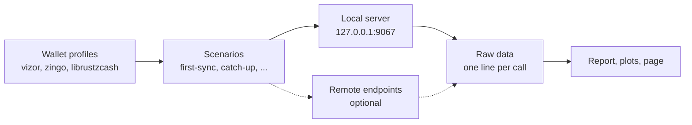

# zcash-walletsync-bench [![X][x-badge]][x]

[x]: https://x.com/zcashlabs
[x-badge]: https://img.shields.io/twitter/follow/zcashlabs

A benchmark for [Zcash](https://z.cash) light-wallet servers, built by [Zcash Labs](https://zcashlabs.com). This tool measures how fast a light wallet can sync from a server.

It replays the requests that real wallets send to a lightwalletd-protocol
server (`CompactTxStreamer` gRPC). It records each call, and it reports the
time a wallet waits.

- The default target is a server on your machine.
- You can also test remote endpoints and compare them.
- The tool only reads public chain data. It does not send transactions.
- The tool does not build or run wallet code.



## Quick start

You need Python 3.11 or newer and a mainnet server that is fully synced.

```sh
git clone https://github.com/zcashlabs/zcash-walletsync-bench
cd zcash-walletsync-bench
python3 -m venv .venv
.venv/bin/pip install .
source .venv/bin/activate
```

Test the server on your machine (plaintext, port 9067):

```sh
zcash-walletsync-bench services               # make sure that the server answers
zcash-walletsync-bench plan catch-up          # show the load; this sends nothing
zcash-walletsync-bench run catch-up first-sync --sizes 1k,10k
```

Test a remote endpoint (TLS):

```sh
zcash-walletsync-bench run catch-up --endpoint mine=lwd.example.org:443 --services mine
```

Compare your server with a public service:

```sh
zcash-walletsync-bench run catch-up --services local,zecrocks
```

The results are in `results/<label>-<UTC time>/`. Read `report.md` first.

## Documentation

| Document | Content |
|---|---|
| [Quick start](docs/quick-start.md) | Install, first run, the usual commands |
| [Services](docs/services.md) | Local server, endpoints, presets, load limits |
| [Scenarios](docs/scenarios.md) | What each scenario does and its options |
| [Wallet profiles](docs/wallet-profiles.md) | The wallet behaviour that each profile copies, with sources |
| [Stress](docs/stress.md) | Find the load at which your server stops scaling |
| [Output](docs/output.md) | The files of a run |
| [Report](docs/report.md) | How to read the statistics |
| [Method](docs/method.md) | How the tool measures, and its limits |
| [Geo sweep](docs/geo-sweep.md) | Latency from many cities through a VPN |
| [Development](docs/development.md) | Tests, protocol stubs, fixtures |

## Rules for remote services

A remote service that you do not operate is a third-party service. The tool
limits the load on it. See [Services](docs/services.md#load-limits).
