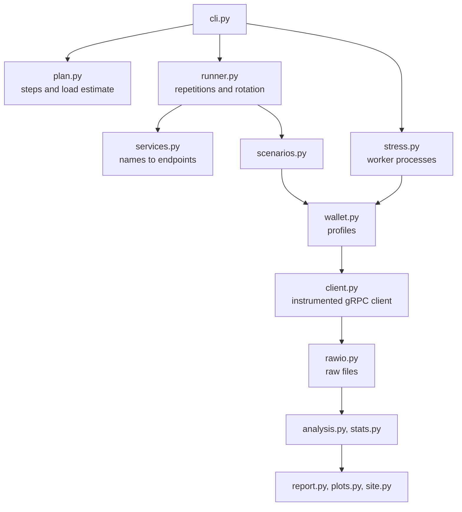

# Development

## Layout

| Path | Content |
|---|---|
| `src/zcash_walletsync_bench/` | The package |
| `src/zcash_walletsync_bench/data/` | Fixed test data (`mainnet.json`) and the block density table (`density.json`) |
| `src/zcash_walletsync_bench/proto/` | Generated protocol stubs |
| `proto/` | Protocol definitions |
| `tests/` | Tests and the fake server |
| `docs/` | Documentation |



## Tests

```sh
.venv/bin/pip install -e ".[dev]"
.venv/bin/python -m pytest -q
```

The tests run offline. They use fake servers in the test process
(`tests/fake_server.py`) with a synthetic chain. They send nothing to real
services.

The tests include:

- the statistics and the bootstrap;
- gap and stall detection;
- the digests and the cross-check;
- the call pattern of each wallet profile;
- deadline accounting and rate-limit handling;
- wallet limits for own and third-party services;
- the stress ramp with two worker processes;
- one full run of each scenario on three fake servers. This run makes sure
  that `report` rebuilds the same statistics and that `plan` gives the exact
  request count.

## Protocol stubs

The files in `proto/` come from the lightwallet-protocol definitions, with
the Ironwood pool. To generate the stubs again:

```sh
.venv/bin/python -m grpc_tools.protoc -Iproto \
  --python_out=src/zcash_walletsync_bench/proto \
  --grpc_python_out=src/zcash_walletsync_bench/proto \
  --pyi_out=src/zcash_walletsync_bench/proto \
  proto/service.proto proto/compact_formats.proto
```

Then make the two imports in the generated files relative
(`from . import ...`).

## Fixed test data

`data/mainnet.json` contains the transactions and addresses for `enhance`
and `transparent`, and the tip for `first-sync`. A fixed rule selects them
from mainnet blocks 3,560,000 to 3,560,199. The rule is in `source.rule` in
the file.

To build the file again from one service:

```sh
zcash-walletsync-bench fixtures --from eu.zec.rocks:443 --window 3560000:3560199 --out my-fixtures.json
zcash-walletsync-bench run enhance --fixtures my-fixtures.json
```

Each run records the file and its SHA-256.
