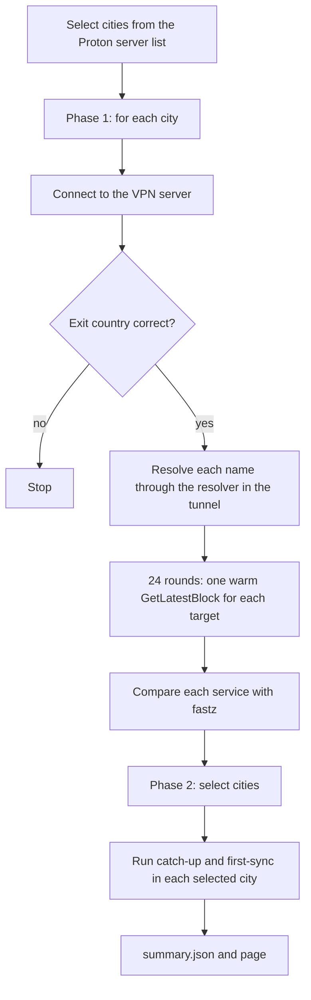

# Geo sweep

`geo-sweep` measures latency from many cities through Proton VPN. Then it
runs wallet syncs in the cities where a different service is nearer than
fastz.

The targets are fixed: `fastz`, each fastz region, `zec.rocks` and its
zones, and `zcashlabs`. This command does not test a local server.

**Warning:** all traffic of this machine goes through the VPN during the
sweep. The command asks before it starts. `--yes` skips the question.

## Requirements

- The Proton VPN command line client (`protonvpn`), signed in.
- VPN Accelerator off: `protonvpn config set vpn-accelerator off`. The
  accelerator can end TCP connections at the VPN server.

## Commands

```sh
zcash-walletsync-bench geo-sweep --plan                        # cities, load and time; sends nothing
zcash-walletsync-bench geo-sweep                               # phase 1, then phase 2
zcash-walletsync-bench geo-sweep --phase 1 --cities US,CA      # only some cities
zcash-walletsync-bench geo-sweep --sweep-dir results/geo-...   # continue a stopped sweep
zcash-walletsync-bench geo-report results/geo-...              # rebuild the summary and the page
zcash-walletsync-bench geo-site results/geo-...                # rebuild only the page
zcash-walletsync-bench geo-map results/geo-...                 # region map
zcash-walletsync-bench geo-compare results/geo-old results/geo-new
```

## Sequence



## City selection

- Cities come from the cached server list of Proton.
- The tool uses only physical exits. It does not use smart-routed locations,
  Secure Core servers or Tor servers.
- The tool drops a city that is nearer than `--thin-km` (150) to a city that
  it keeps.
- `--cities` and `--exclude` take country codes, city names or keys.

## Phase 1: latency

Each city takes 1 to 2 minutes.

1. The tool connects to the physical server with the best score.
2. It checks the exit country with the Cloudflare trace on `1.1.1.1`. If the
   traffic does not go through the VPN, the tool stops.
3. It resolves each name through the Proton resolver in the tunnel. The
   system resolver can be outside the tunnel.
4. It compares the outgoing address of the resolver with the exit. DNS
   steering can follow the location of the resolver.
5. It runs `--rounds` (24) rounds. Each round makes one warm `GetLatestBlock`
   call for each target, in random sequence.
6. Each round also times a DNS query to the Proton resolver. This is the
   tunnel baseline.

## How to read the numbers

- Absolute numbers include the path from this machine to the VPN server.
  Compare the hosts in one city only.
- The report gives the latency of each service minus the latency of fastz,
  paired by round, with a bootstrap 95% CI.
- The tool selects the best zone of a group on the even rounds and compares
  it on the odd rounds.
- Latency minus the tunnel baseline is an estimate of the latency for a user
  in that city.

## Phase 2: syncs

The tool selects:

- a maximum of `--sync-cities` (8) cities where a different service was
  faster than fastz;
- `--controls` (2) cities where fastz was faster by a small margin.

In each city it connects again and runs `run catch-up first-sync` with
`--behind 1d --sizes 10k --reps 3`. It pins each name to the address that
the Proton resolver returned. Each city gives a normal run directory.

## Output

The sweep writes `results/geo-<time>/`:

| File | Content |
|---|---|
| `sweep.json` | Options, Proton client and settings |
| `cities.jsonl` | Phase 1: one line for each city |
| `syncs.jsonl`, `runs/` | Phase 2 |
| `logs/` | Logs |
| `summary.json` | The table that `geo-report` prints |
| `site/` | The pages |

The tool does not store the exit IP address.
