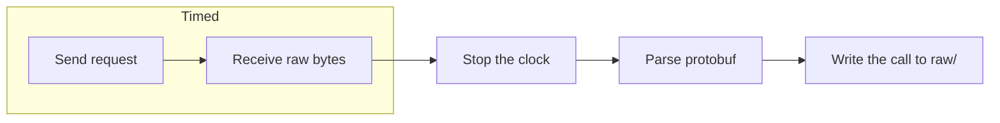

# Method

## What the tool measures

The tool measures the network traffic of a wallet sync. A fixed mix of
single calls shows the latency of one call. It does not show how long a
wallet waits to restore, to catch up, or to see a new block. Thus each
scenario copies a full wallet task.

- Each RPC goes through one instrumented client.
- Responses stay as bytes in the timed section. The tool parses them after
  the call ends. Thus Python parse time does not count as server time.
- Bytes are protobuf message bytes. HTTP/2 and TLS framing are not included.
- Each simulated wallet has its own connection.
- The tool ignores HTTP proxy settings.

## Statistics, not single numbers

- Each step runs many times. See [Scenarios](scenarios.md#repetitions).
- The tool keeps each call and each stream message in raw files.
- The report gives distributions with confidence intervals. See
  [Report](report.md).

## HTTP/2 receive window

Rust wallets use tonic. Tonic keeps the hyper client defaults: a fixed 2 MiB
stream window and a 5 MiB connection window, with no adaptive window.
On a long network path, the receive window limits the transfer rate.

| `--h2-window` | Behaviour |
|---|---|
| `wallet` (default) | 2 MiB stream window, no BDP probes, as the wallets have |
| `grpc` | grpc-core defaults: 64 KiB at first, then growth by BDP probes |

grpc-core cannot set the connection window independently. The copy is near,
but not exact.

On a local link the window has almost no effect.

## Limits

- **Python client.** One Python process uses approximately one core.
  `stress` divides the wallets between worker processes and measures the
  client. See [Stress](stress.md).
- **Network traffic only.** A real wallet also does trial decryption between
  batches. The tool does not model that time.
- **Local runs.** A local run removes the network. It shows the cost of the
  server itself. It does not show what a remote user gets.
- **Same machine.** When the client and the server share a machine, they
  share CPU, memory and disk. Heavy scenarios (`scale`, `stress`) can then
  show the limit of the machine, not of the server.
- **Remote runs.** Results depend on the location and the network of the
  client. Compare servers from the same place, and report the location with
  the numbers. A noisy link makes the CIs wider. More repetitions make them
  narrower.
- **Plan estimates.** `plan` request counts are exact. Byte estimates use a
  density table from 2026-11-13. They can be wrong by a factor of 2.
- **Mainnet only.** The fixed data is from mainnet.
- **zodl SDKs.** The tool does not model them. See
  [Wallet profiles](wallet-profiles.md#not-included).
