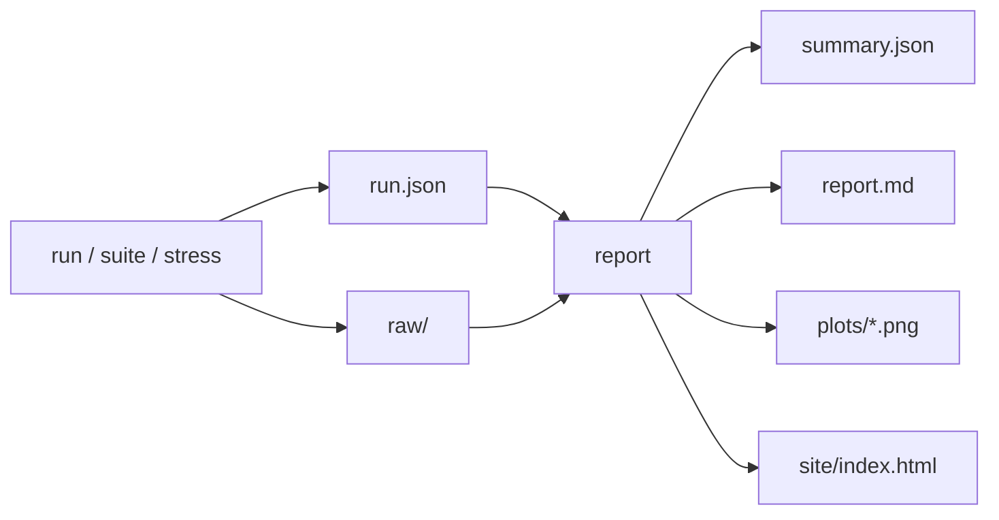

# Output

Each run writes one directory: `<out-dir>/<label>-<UTC time>/`. The default
`--out-dir` is `results`. The default `--label` is `run`.



`report RUN_DIR` calculates everything again from `run.json` and `raw/` only.

## Files

| File | Content |
|---|---|
| `run.json` | Environment, options, services, profiles with sources, fixed data, the plan |
| `raw/calls.jsonl.gz` | One line for each RPC |
| `raw/messages.csv.gz` | One row for each message of each server stream |
| `raw/connections.jsonl.gz` | One line for each connection: setup time or error |
| `raw/runs.jsonl.gz` | One line for each step, repetition and service |
| `raw/tips.jsonl.gz` | Tip snapshots: the height and lag of each service at the same moment |
| `raw/crosscheck.json` | Correctness comparison for each step |
| `raw/client.jsonl.gz` | Stress: client CPU, memory, scheduling delay and parse time for each level |
| `raw/stress/<service>/w<N>/p<i>/` | Stress: the raw files of each worker process for one level |
| `summary.json` | All statistics |
| `report.md` | Tables for each step |
| `plots/*.png` | Latency CDFs, block download against time, load curve, tip lag, soak |
| `site/index.html` | A page with figures. `site/plots/*.svg` and `site/data/*.csv` contain each figure and its numbers |

## Fields of `raw/calls.jsonl.gz`

| Field | Content |
|---|---|
| `call_id`, `conn_id` | Identifiers of the call and of its connection |
| `service`, `step`, `scenario`, `rep`, `round`, `wallet` | Where the call belongs |
| `purpose` | Why the wallet made the call, for example `batch`, `verify`, `poll` |
| `method` | RPC name |
| `started_s` | Seconds from the start of the run |
| `connect_ms` | Connection setup time. Only on the first call of a connection |
| `ttfb_ms` | Time to the first response message |
| `latency_ms` | Time to the last message or status |
| `messages`, `bytes` | Messages and protobuf bytes received |
| `status` | gRPC status name, or `SHORT_STREAM` |
| `timeout_s` | Deadline sent with the call |
| `max_gap_ms`, `stalls`, `stall_ms` | Streams: longest gap, number of stalls, total stall time |

## Fields of `raw/messages.csv.gz`

`call_id`, `seq`, `t_ms` (time from the start of the call), `bytes`.

## Read the raw data

```python
import pandas as pd
calls = pd.read_json("results/<run-dir>/raw/calls.jsonl.gz", lines=True)
messages = pd.read_csv("results/<run-dir>/raw/messages.csv.gz")
```

## Privacy

The files record:

- the Python, grpcio and OS versions;
- the endpoint of each service;
- the Cloudflare site and country of the client, if the run includes a
  remote service and you did not give `--no-geo`.

The files do not record an IP address of the client, a hostname or a
username.
