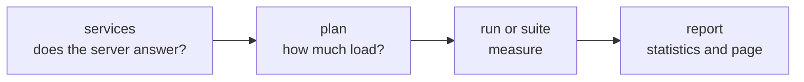

# Quick start

## Requirements

- Python 3.11 or newer.
- A lightwalletd-protocol server on Zcash mainnet. The server must be fully
  synced. The fixed test data uses blocks near height 3,560,000.

## Install

```sh
git clone https://github.com/zcashlabs/zcash-walletsync-bench
cd zcash-walletsync-bench
python3 -m venv .venv
.venv/bin/pip install .
source .venv/bin/activate
```

This installs the command `zcash-walletsync-bench`. You can also use
`python -m zcash_walletsync_bench`.

`requirements.txt` contains the exact versions that the tests use.

## Sequence of a run



## 1. Make sure that the server answers

```sh
zcash-walletsync-bench services
```

The default service is `local`: `plain://127.0.0.1:9067` (plaintext). If your
server uses a different address, set it:

```sh
zcash-walletsync-bench services --endpoint local=plain://127.0.0.1:8137
```

Add the same `--endpoint` option to each command that follows.

## 2. Look at the load

`plan` sends nothing. It prints the requests of each step. Request counts are
exact. Bytes and time are estimates.

```sh
zcash-walletsync-bench plan                        # the full suite
zcash-walletsync-bench plan first-sync --verbose   # each request of one repetition
```

For a local server, give estimates that agree with a local link:

```sh
zcash-walletsync-bench plan --assume-rtt-ms 1 --assume-mbps 50
```

## 3. Run

Run one or more scenarios:

```sh
zcash-walletsync-bench run catch-up
zcash-walletsync-bench run first-sync --sizes 1k,10k --profile vizor,zingo
zcash-walletsync-bench run catch-up --behind 1h,1d,1w --reps 20
```

Run the full suite:

```sh
zcash-walletsync-bench suite --label my-server
```

The suite sends about 4,100 requests and 1 GB. It takes 40 minutes or more:
the soak (30 minutes) and tip-follow (10 minutes) have a fixed duration.
`--soak-min 0` removes the soak.

If no service answers, the tool stops and measures nothing.

## 4. Read the results

Each run writes `results/<label>-<UTC time>/`.

```sh
zcash-walletsync-bench report results/<run-dir>   # rebuild statistics, plots and page
```

- `report.md` contains the tables.
- `site/index.html` is a page with figures. `report` writes it.

See [Output](output.md) and [Report](report.md).

## Test a remote endpoint

Give the endpoint a name, then select the name:

```sh
zcash-walletsync-bench run catch-up --endpoint mine=lwd.example.org:443 --services mine
```

`HOST:PORT` uses TLS. `plain://HOST:PORT` uses plaintext.

## Compare services

Give a comma list. Each service gets the same requests for the same blocks.

```sh
zcash-walletsync-bench run catch-up first-sync --services local,zecrocks,zcashlabs
```

With two or more services, the tool also compares their answers. See
[Report](report.md#correctness).

## Commands

| Command | Function |
|---|---|
| `services` | Connect to each service and print its `GetLightdInfo` |
| `plan [SCENARIO ...]` | Print the load. Send nothing |
| `run SCENARIO ...` | Run scenarios |
| `suite` | Run the recommended full plan |
| `stress` | Ramp the number of wallets on your server. See [Stress](stress.md) |
| `report RUN_DIR` | Rebuild statistics, report, plots and page from the raw data |
| `site RUN_DIR` | Rebuild only the page |
| `profiles` | Print the wallet profiles and their sources |
| `fixtures` | Rebuild the fixed test data. See [Development](development.md) |
| `geo-*` | See [Geo sweep](geo-sweep.md) |

`zcash-walletsync-bench COMMAND --help` lists all options.
