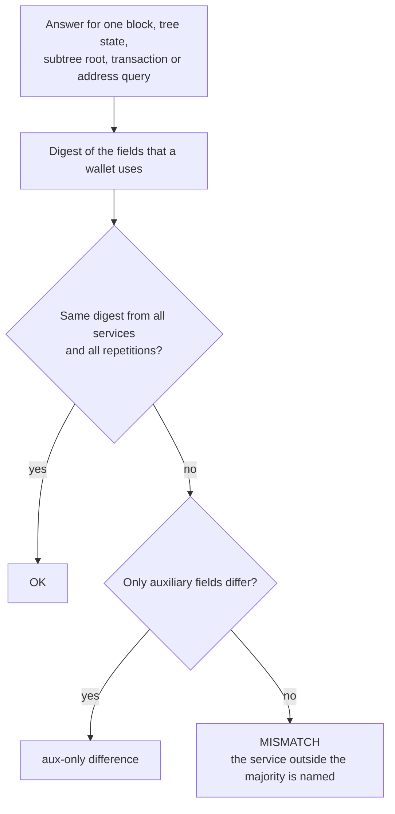

# Report

This document tells you how to read `report.md` and the page.

## Distributions

Each table gives n, mean, standard deviation, min, p5, p25, p50, p75, p90,
p95, p99, max, and a 95% confidence interval (CI) of the median.

- For 5,000 values or less, the CI is a bootstrap with 2,000 resamples and a
  fixed seed.
- For more values, the CI is the order-statistic interval.
- With less than 3 values there is no CI.

## Metrics for each repetition

Each repetition gives one value for each metric.

| Metric | Meaning |
|---|---|
| `wall_s` | Total time of the task |
| `time_to_first_block_s` | Time until the first block arrives |
| `mbytes_per_s` | Download rate |
| `prelude_s` | Time of the calls before the first block request |
| `blocks_phase_s` | Time of the block download |
| `tail_s` | Time after the last block |

## Comparison

The comparison needs two or more services.

For each key metric and for the latency of each method, the report gives:

- the median of each service divided by the median of the best service;
- a bootstrap 95% CI of that ratio;
- a Mann-Whitney p-value.

If the CI contains 1, the report says *not significant*. This run cannot
tell the two services apart.

## Call latency

The tables use warm calls only. The first call on a connection includes
connection setup. The report gives `connect_ms` separately.

## Block streams

For `GetBlockRange` the report gives:

- the time to the first block;
- the transfer rate: bytes divided by the stream time after the first block;
- the rate in 1 s intervals of each stream. A low p5 shows dips;
- the longest gap between two blocks;
- stalls: gaps above `--stall-s` (default 2 s), and their total time.

The throughput plot shows MB/s for each second of each repetition.

## Load curve

From `scale`: aggregate MB/s, MB/s for each wallet, first-block time and
error rate against the number of wallets.

## Errors

For each method, the report counts calls by gRPC status. `SHORT_STREAM`
means that a stream ended without an error but with fewer blocks than the
request.

## Wallet deadlines

The report counts the calls that were too slow for the deadline of each
wallet.

| Wallet | Unary | Stream |
|---|---|---|
| Vizor | 20 s | 20 s to the first message, 30 s between messages |
| Zingo | 10 s | 20 s total for `GetBlockRange`, 15 s between messages |
| librustzcash | none | none |

"Streams re-opened" counts the Zingo resumes in the run. See
[Wallet profiles](wallet-profiles.md#stream-deadline).

## Tip freshness

- Lag: the number of blocks behind the highest service at the same moment.
- Delay: the number of seconds after the first service that each service
  reported a new block. This comes from `tip-follow` and `soak`.
- The resolution is the observer interval (`--observe-s`, default 3 s).

With one service, lag and delay are always zero.

## Correctness

A fast answer that is incorrect is not a good result. The tool compares the
answers.

- The digest includes: block hash, `prevHash`, txids, each Sapling, Orchard
  and Ironwood element, tree sizes, tree-state strings, subtree root hash and
  height, and raw transaction bytes.
- Auxiliary fields are fields that servers can fill differently without
  harm: block time, fee, transparent data, and the `completingBlockHash` of
  a subtree.
- With one service, the tool compares the repetitions with each other. An
  answer that changes between repetitions is a mismatch.
- To compare a local server with a reference, add a second service:
  `--services local,zecrocks`.
