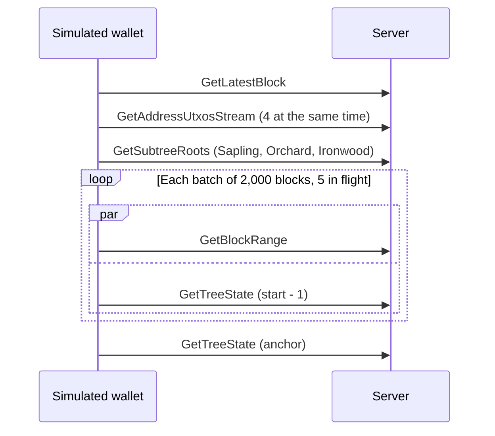

# Scenarios

A scenario copies one thing that a wallet does. A scenario uses a
[wallet profile](wallet-profiles.md) to decide which requests to send, in
which sequence, and how many at the same time.

```sh
zcash-walletsync-bench run SCENARIO [SCENARIO ...]
zcash-walletsync-bench run all
```

## List

| Scenario | What it copies | Main options |
|---|---|---|
| `app-open` | A wallet app starts: new connection, `GetLightdInfo`, `GetLatestBlock`, then a `GetBlockRange` of 1 block or 100 blocks | `--app-open-samples` |
| `first-sync` | Restore from a birthday: the full sync of the profile for the last N blocks before a fixed tip | `--sizes` (default `1k,10k,50k`) |
| `catch-up` | A wallet comes back after an absence: verify range, then batches up to the tip | `--behind` (default `1h,1d,1w`) |
| `enhance` | Get full transactions after the wallet finds notes (`GetTransaction`) | `--txids` (default 40) |
| `transparent` | UTXO refresh and transaction history for transparent addresses | `--full-history-addrs` |
| `mixed` | N wallets on one service at the same time, each with a different task | `--wallets`, `--seed` |
| `scale` | Load curve: 1, 2, 4, 8 wallets start the same catch-up at the same moment | `--scale-levels`, `--scale-behind` |
| `tip-follow` | An idle wallet with the app open: poll each 10 s, sync when the tip moves, hold a mempool stream | `--duration-s`, `--poll-s` |
| `mempool` | Hold `GetMempoolStream` open on each service | `--duration-s` |
| `soak` | Long run: polls, a mempool stream, and periodic app-open, catch-up and enhance tasks | `--soak-min` (default 30) |

`--profile` selects the wallet profiles. It takes a comma list. The default
is `vizor`.

## Sequence of a catch-up (Vizor profile)



`plan SCENARIO --verbose` prints the exact requests for each profile.

## Fixed and live data

- `first-sync`, `enhance` and `transparent` use fixed mainnet data. The tip
  of `first-sync` is block 3,559,999. The transactions and addresses come
  from blocks 3,560,000 to 3,560,199.
- `catch-up`, `app-open`, `mixed` and `scale` use the live tip. The tool
  reads the tip of each service at the start of the step and uses the lowest
  one. All repetitions and all services then ask for the same blocks.
- Each run records the fixed data and its SHA-256.

## Repetitions

- Each step runs `--reps` times. The defaults are 10 for short steps, 5 for
  `first-sync`, 3 for each `scale` level, and 1 for steps with a fixed
  duration.
- In each repetition, each service runs one time.
- The sequence of the services moves by one position in each repetition.
  Thus a slow minute on the network does not always affect the same service.
- The tool keeps each repetition.
- `tip-follow`, `mempool` and `soak` run all services at the same time.
  Their sample size is their duration.

## Suite

`suite` runs this plan:

| Step | Repetitions |
|---|---|
| `app-open` | 10 |
| `catch-up` 1h, 1d, 1w | 10 each |
| `first-sync` 1k, 10k (Vizor) | 5 each |
| `first-sync` 50k (Vizor) | 3 |
| `first-sync` 10k (Zingo, librustzcash) | 5 each |
| `enhance` (Vizor, Zingo) | 10 each |
| `transparent` | 5 |
| `mixed` | 10 |
| `scale` 1, 2, 4, 8 wallets | 3 each |
| `tip-follow` | 10 minutes |
| `soak` | 30 minutes |

`plan` with no scenario prints the load of the suite.
