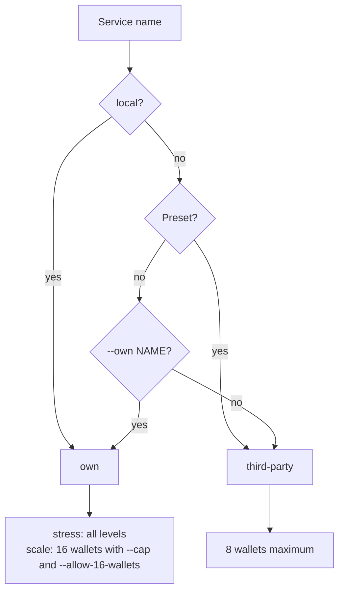

# Services

A service is one server address with a name. `--services` takes a comma list
of names. The default is `local`.

The tool talks to each service through the `CompactTxStreamer` gRPC API only.
It sends the same requests to each service. It does not detect the server
software.

## Names

| Name | Kind | Endpoint |
|---|---|---|
| `local` | own | `plain://127.0.0.1:9067`, or the address from `--endpoint local=...` |
| a name from `--endpoint NAME=...` | third-party, or own with `--own NAME` | your address |
| `zecrocks` | third-party preset | one zone of `zec.rocks:443` (see below) |
| `zcashlabs` | third-party preset | `lwd.zcashlabsrpc.dev:443` |
| `fastz` | third-party preset | `rpc.fastz.cash:443` (DNS selects the region) |
| `fastz-usw`, `-use`, `-eu`, `-ap`, `-sa`, `-jp`, `-lon` | third-party preset | `<region>.fastz.cash:443` |

## Endpoint format

| Format | Transport |
|---|---|
| `HOST:PORT` | TLS |
| `HOST` | TLS, port 443 |
| `plain://HOST:PORT` | plaintext (h2c) |

Examples:

```sh
--endpoint local=plain://127.0.0.1:8137              # local server on a different port
--endpoint mine=lwd.example.org:443 --services mine  # remote server
--endpoint a=10.0.0.5:443 --endpoint b=10.0.0.6:443 --services a,b
```

You cannot use `--endpoint` to change a preset.

## Own and third-party



- An own service is a server that you operate.
- `--own NAME` tells the tool that you operate the `--endpoint` with that
  name. Use it only for your servers.
- A preset is always third-party. `--own` does not change a preset.
- `report.md` and `run.json` record the kind of each service.

## Load limits

These limits apply to each run:

- Services run one at a time. The exceptions are `tip-follow`, `mempool` and
  `soak`: they only poll, and they hold one stream for each service.
- One simulated wallet has at most `--max-concurrency` block batches in
  flight. The default is 5. The maximum is 8.
- `scale` puts at most `--max-wallets` wallets on a service. The default and
  the maximum are 8.
- `--cap NAME=N` sets a different limit for one service. A limit above 8 is
  possible only for an own service, and you must also give
  `--allow-16-wallets`. The maximum is 16.
- `stress` refuses levels above 8 wallets for a third-party service.
- `--sizes` has a maximum of 50,000 blocks.
- If a server answers `429` or `RESOURCE_EXHAUSTED`, the tool sends no more
  calls to that server in the run.

## zec.rocks zones

`zecrocks` uses one of the zones `na`, `sa`, `eu`, `ap`, `me`.

- `--zecrocks-zone auto` (the default) selects the zone with the lowest
  latency. The tool makes one warm-up call and 7 `GetLightdInfo` calls on one
  connection for each zone. It uses the median.
- `--zecrocks-zone eu` (or a different zone) selects that zone.
- `--zecrocks-zone global` uses `zec.rocks:443`. `auto` does not select it.

zec.rocks uses anycast. TCP connect time does not show the distance to the
backend. That is why the tool uses a gRPC call.

## Address selection

- `--ipv4` connects through IPv4 only. Use it when the services do not all
  have IPv6.
- `--resolve HOST=IP` connects to a fixed IPv4 address for a name, as
  `curl --resolve` does. TLS continues to use the name.

## Location lookup

When a run includes a remote service, the tool asks Cloudflare for the site
and country of the client. It records only those two values. `--no-geo`
stops this. A run with only local services does not make the lookup.
