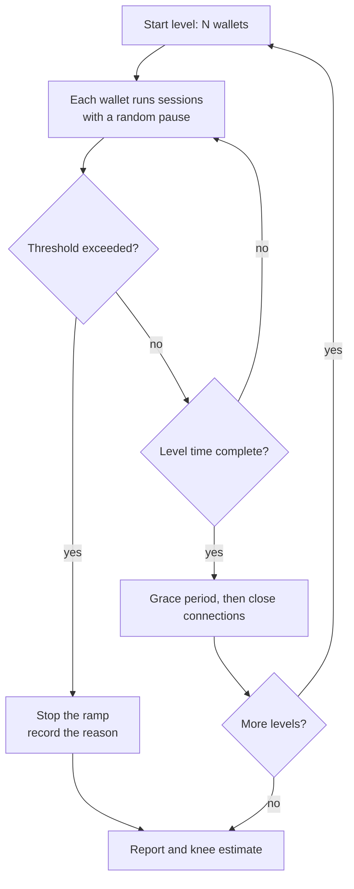

# Stress

`stress` finds the load at which a server stops scaling. It increases the
number of wallets at the same time, level by level.

Use `stress` only on a server that you operate. For a third-party service,
the tool refuses levels above 8 wallets.

```sh
zcash-walletsync-bench plan stress                 # print the plan; send nothing
zcash-walletsync-bench stress                      # stress the local server
zcash-walletsync-bench stress --endpoint mine=lwd.example.org:443 --own mine --services mine
```

`stress` prints the plan and then asks for `yes`. Use `--yes` when no
terminal is attached.

## Ramp



| Option | Default | Function |
|---|---|---|
| `--levels` | `1,2,4,8,16,32,64,128,256` | Wallets at the same time for each level |
| `--level-s` | 60 | Seconds for each level |
| `--stress-sessions` | 0 | Stop a level after this number of sessions (0: use `--level-s`) |
| `--stress-mix` | `catch-up-1h:40,catch-up-1d:20,first-sync:10,enhance:15,poll:15` | Session types and their weights |
| `--stress-think-s` | 1 | Mean pause between two sessions of a wallet |
| `--stress-grace-s` | 30 | Time for sessions to complete after a level |
| `--stress-cooldown-s` | 10 | Pause between levels |
| `--stress-reconnect` | off | New connection for each session |

Each wallet keeps one connection and runs sessions one after the other. A
session is one item of the mix. It sends the same requests that the wallet
profile sends for that task.

## Stop thresholds

A level stops, and the ramp stops, when one of these conditions is true:

| Condition | Option | Default |
|---|---|---|
| Error rate is too high | `--stop-error-rate` | 0.05 |
| p99 latency of unary calls is too high | `--stop-p99-ms` | 10,000 |
| p99 time to the first block of `GetBlockRange` is too high | `--stop-first-block-p99-ms` | 20,000 |

The tool applies the thresholds after `--stop-min-calls` calls (default 50).
It calculates the p99 values from the last `--stop-window-s` seconds
(default 15). The report records the reason.

## The client must not be the limit

The wallets run in `--client-procs` worker processes. The default is half of
the logical CPUs, with a maximum of 16. Each process has its own connections.

For each level the tool records:

- the CPU of each worker and of each core;
- memory;
- a scheduling probe: how late a 20 ms sleep wakes up;
- the time to parse protobuf.

The tool marks a level as *client-limited* when one of these is true:

- a worker uses 90% or more of a core;
- the p99 of the probe is 100 ms or more;
- the machine is 90% or more busy.

If a level is client-limited, add worker processes or use a faster client
machine.

**Caution:** when the server is on the same machine, the client and the
server share the CPUs. Read the *client-limited* column before you read the
knee. For a clean result, run the client on a second machine.

## Results

For each level and service, the report gives:

- wallets, sessions, requests per second;
- aggregate MB/s, and MB/s for each wallet (p5 and p50);
- unary latency p50, p90 and p99, also for each method;
- first-block time p50 and p99;
- error rate by status;
- wallet deadline hits;
- the client measurements.

The knee estimate is the last level before one of these occurred:

- requests per second increased by less than 10%;
- unary p99 became more than two times larger, and is above 200 ms;
- the error rate went above 1%.

`plots/stress.png` shows requests per second, MB/s, p99, errors, client CPU
and scheduling delay against the number of wallets.

Stress steps do not include the correctness check.
