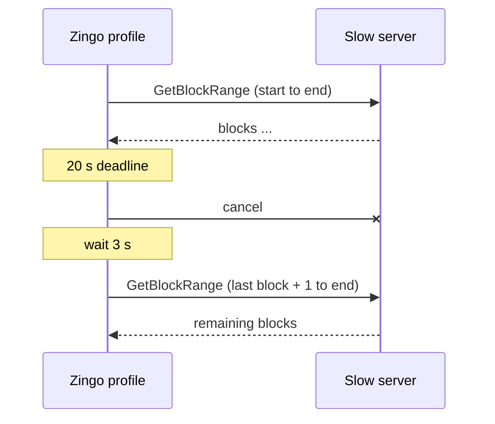

# Wallet profiles

A profile is a description of how one wallet syncs: the RPCs, their
parameters, their sequence and their concurrency. Each profile comes from the
source code of a wallet.

- The tool reads no wallet code at run time.
- The tool replays the call patterns with its own gRPC client.
- `zcash-walletsync-bench profiles` prints each profile and its sources.
- Each result file contains the sources.

Paths in this document are relative to the repository of each project.

| Profile | Wallet | Requests at the same time | Batch |
|---|---|---|---|
| `vizor` (default) | Vizor sync engine | 5 block batches, each with a tree state | 2,000 blocks |
| `librustzcash` | librustzcash `sync::run`, WebZjs | 1 | 10,000 blocks |
| `zingo` | Zingo `pepper-sync` | 1 | one note-commitment shard |

## Vizor

Source: the Vizor sync engine at commit `43c1b34`
(`vizor-rust/src/wallet/sync_engine/`).

| Phase | Behaviour | Source |
|---|---|---|
| Start | `GetLatestBlock` | `mod.rs:3821` |
| Start | `GetAddressUtxosStream`, 20 external addresses, 4 at the same time | `mod.rs:263-267` |
| Start | `GetSubtreeRoots` for Sapling, Orchard and Ironwood, `maxEntries=0` | `lwd.rs:842-972` |
| Blocks | 2,000 blocks for each `GetBlockRange` | `mod.rs:363` |
| Blocks | 4 batches download ahead of the batch in the scan: 5 in flight | `mod.rs:237` |
| Blocks | Each batch sends `GetBlockRange` and `GetTreeState(start-1)` together | `mod.rs:2797-2818` |
| After a batch | `GetLatestBlock`, if the batch ends less than 10,000 blocks from the tip | `mod.rs:769-780` |
| End | One `GetTreeState` for the anchor check | `mod.rs:1621` |
| Timeouts | Unary 20 s, stream idle 30 s | `lwd.rs:50-53` |
| Enhancement | `GetTransaction`, one at a time | `enhancement/payload/public.rs:66-79` |
| Mempool | `GetMempoolStream` on its own connection. The wallet opens it again when the server ends it at a new block | `mempool.rs:462-497,652` |
| Idle | The app polls `GetLatestBlock` each 10 s and syncs when the tip moves | `vizor-wallet/lib/src/providers/sync_provider.dart:1802-1845` |

A test compares this profile with a recorded sync of the real wallet. For
20,001 blocks, the two send the same counts: `GetBlockRange` x11,
`GetTreeState` x12, `GetSubtreeRoots` x3, `GetAddressUtxosStream` x2.

## librustzcash and WebZjs

Source: `librustzcash/zcash_client_backend/src/sync.rs`.

| Phase | Behaviour | Source |
|---|---|---|
| All | One request at a time on one connection. Downloads do not overlap with the scan | `sync.rs:3-10` |
| Start | `GetSubtreeRoots` for each pool, `startIndex=0`, `maxEntries=0` | `sync.rs:271-295` |
| Start | `GetLatestBlock` | `sync.rs:314-325` |
| Start | One `GetAddressUtxosStream` for each account | `sync.rs:511-528` |
| Blocks | `GetBlockRange`, then `GetTreeState(start-1)` | `sync.rs:180-201` |
| Blocks | The library has no default chunk size. WebZjs uses 10,000 | `WebZjs/crates/webzjs-wallet/src/wallet.rs:60` |
| Catch-up | First a verify range of 10 blocks | `zcash_client_sqlite/src/lib.rs:179` |

## Zingo

Source: `zingolib/pepper-sync/src/`.

| Phase | Behaviour | Source |
|---|---|---|
| All | One task sends all requests, one at a time | `client/fetch.rs:30-51` |
| Deadlines | 10 s for unary calls, 20 s for `GetBlockRange` | `zingo-netutils/src/time.rs:173,178` |
| Start | `GetSubtreeRoots` for the three pools at the same time. One more request for each pool must return nothing | `sync.rs:2244-2248`, `client.rs:229-238` |
| Start | `GetTreeState` at the birthday, at the birthday - 1, and at the tip | `sync.rs:2353-2382`, `sync/state.rs:871-986` |
| Blocks | Verify the top 10 blocks first | `sync.rs:72` |
| Blocks | One stream for each range. A range is at most one note-commitment shard | `sync/state.rs:733-755` |
| Transparent | `GetTaddressTxids` for each known address for `[last-100, tip]`, then one empty probe for each scope | `zingolib/src/config.rs:471-473` |
| Enhancement | `GetTransaction`, 2 workers | `scan/transactions.rs:97-107`, `scan/task.rs:39` |
| Mempool | `GetMempoolStream`. The wallet opens it again immediately when it ends | `sync.rs:2468-2470` |

### Stream deadline

When a stream is not complete after 20 s, Zingo stops it, waits 3 s, and
opens it again from the last block that it received
(`scan/task.rs:394-433`). A slow server thus costs a Zingo wallet more round
trips and 3 s pauses. The report counts these as `resumes`.

## Not included

- The zodl Android and iOS SDKs. Their batch sizes and poll interval are not
  known to this tool. The zodl apps do a server check when they start: a
  `GetBlockRange` of 1 block, or of 100 blocks in the server setup screen
  (`zodl-ios/secant/Sources/Features/ServerSetup/ServerSetupStore.swift:26-31`).
  The `app-open` scenario copies that check.
- zallet. It does not use lightwalletd.
